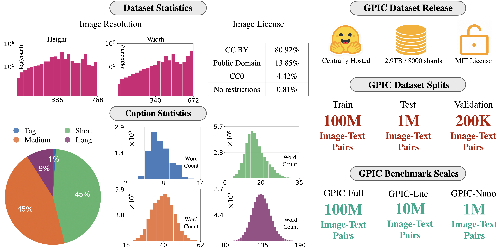

<h1 align='center' style="text-align:center; font-weight:bold; font-size:2.0em;letter-spacing:2.0px;">
    GPIC: A Giant Permissive Image Corpus for Visual Generation</h1>
<p align='center' style="text-align:center;font-size:1.25em;">
    <a href="https://keshik6.github.io/" target="_blank" style="text-decoration: none;">Keshigeyan&nbsp;Chandrasegaran</a><sup>*1</sup>,&nbsp;
    <a href="https://kylesargent.github.io/" target="_blank" style="text-decoration: none;">Kyle&nbsp;Sargent</a><sup>*1</sup>,&nbsp;
    <a href="https://www.suchiragarwal.com/" target="_blank" style="text-decoration: none;">Suchir&nbsp;Agarwal</a><sup>1</sup>,&nbsp;
    <a href="https://mjang01011.github.io/portfolio/" target="_blank" style="text-decoration: none;">Michael&nbsp;Jang</a><sup>1</sup>,&nbsp;<br/>
    <a href="https://zymrael.github.io/" target="_blank" style="text-decoration: none;">Michael&nbsp;Poli</a><sup>1,2</sup>,&nbsp;
    <a href="https://www.niebles.net/" target="_blank" style="text-decoration: none;">Juan&nbsp;Carlos&nbsp;Niebles</a><sup>1,4</sup>,&nbsp;
    <a href="https://cs.stanford.edu/people/jcjohns/" target="_blank" style="text-decoration: none;">Justin&nbsp;Johnson</a><sup>3</sup>,&nbsp;
    <a href="https://jiajunwu.com" target="_blank" style="text-decoration: none;">Jiajun&nbsp;Wu</a><sup>1</sup>,&nbsp;
    <a href="https://profiles.stanford.edu/fei-fei-li" target="_blank" style="text-decoration: none;">Li&nbsp;Fei-Fei</a><sup>1</sup><br/>
<span class="author-block"><sup>1</sup>&nbsp;Stanford University&nbsp;&nbsp;</span>
<span class="author-block"><sup>2</sup>&nbsp;Radical Numerics&nbsp;&nbsp;</span>
<span class="author-block"><sup>3</sup>&nbsp;University of Michigan&nbsp;&nbsp;</span>
<span class="author-block"><sup>4</sup>&nbsp;Salesforce Research&nbsp;&nbsp;</span><br/>
<sup>*</sup>&nbsp;Equal contribution<br/>
<a href="https://arxiv.org/abs/2605.30341" title="arXiv" target="_blank" rel="nofollow" style="text-decoration: none;">📄 arXiv</a> |
<a href="https://gpic.stanford.edu" title="Website" target="_blank" rel="nofollow" style="text-decoration: none;">🌎 Website</a> |
<a href="https://huggingface.co/datasets/stanford-vision-lab/giant-permissive-image-corpus" title="Dataset" target="_blank" rel="nofollow" style="text-decoration: none;">🤗 Dataset</a> |
<a href="https://huggingface.co/stanford-vision-lab/gpic-baselines" title="Models" target="_blank" rel="nofollow" style="text-decoration: none;">🤗 Models</a> |
<a href="https://github.com/keshik6/gpic" title="Evaluation Toolkit" target="_blank" rel="nofollow" style="text-decoration: none;">🥇 Evaluation toolkit</a>
</p>

<p align="center">

</p>


## 📣 News

- **[2026-05-28]: GPIC benchmark dataset released**

## Abstract

Studying scalable methods for visual generative modeling requires large, accessible, and stable datasets.
We introduce **GPIC**, a **G**iant **P**ermissive **I**mage **C**orpus of approximately **28 trillion pixels**.
GPIC comprises diverse internet images captioned by a state-of-the-art vision-language model, including 100M training, 200K validation, and 1M test examples.
Moreover, all GPIC images are permissively licensed for both research and commercial use.
GPIC is safety-filtered, deduplicated, and centrally hosted on Hugging Face.
We provide a benchmarking protocol for generative modeling on GPIC.
Finally, we provide a reference baseline for pixel-space flow matching on GPIC.
Our dataset, benchmark, and models are available on [Hugging Face](https://huggingface.co/datasets/stanford-vision-lab/gpic).
Evaluation toolkit and code are available at [gpic.stanford.edu](https://gpic.stanford.edu).
We hope GPIC supports open, accessible, and reproducible research on large-scale visual generative modeling.

## GPIC Statistics
<p align="center">
  
</p>

## Dataset Organization

There are 8000 tars for GPIC train, 32 tars for validation, and 128 tars for test.
```
giant-permissive-image-corpus/
├── train/      (8000 files, gpic_train_{00000–07999}.tar)
├── val/        (32 files,  gpic_val_{00000–0031}.tar)
├── test/       (128 files,  gpic_test_{00000–00127}.tar)
├── .gitattributes
└── README.md
```

### Tar File Format

Each tar archive contains alternating image–metadata pairs:

- `{key}.json` — metadata and caption  
- `{key}.jpg` / `{key}.png` — corresponding image  

Files are stored sequentially such that each JSON entry is followed by its corresponding image. For example:

```
{key_1}.json
{key_1}.jpg
{key_2}.json
{key_2}.png
{key_3}.json
{key_3}.jpg
```

### JSON Format
Each json includes metadata in the following format:

```
{
    "retrieved_at": str,
    "license": str,
    "license_url": str,
    "attribution": str,
    "key": str,              # unique identifier for the image
    "img_width": int,
    "img_height": int,
    "split": [str],          # dataset split, one of {"nano", "lite", "full"}
    "caption_type": str,     # one of {"tag", "short", "medium", "long"}
    "caption": str
},
// Next image record
```

## Baselines

The baseline code is located in `baselines/PixelGen/`. Our implementation builds on [PixelGen](https://github.com/Zehong-Ma/PixelGen) by Ma et al.

**Installation**
```bash
conda create -n pixgen python=3.10
conda activate pixgen
cd baselines/PixelGen
pip install -r requirements.txt
```

**Training**
```bash
cd baselines/PixelGen
sbatch sbatch_pretrain_gpic_full_jit.sh
```

**Sampling**
```bash
cd baselines/PixelGen
sbatch sbatch_sample_wl.sh
```
Update `--ckpt_path` in the script to point to your checkpoint.

**Evaluation**
```bash
# First install the GPIC evaluation toolkit
cd gpic_eval
pip install -e .
cd ../baselines/PixelGen
bash benchmark_jit_gpic_full.sh
```
Update `PRED_DIRS` and `REF_NPZ` in the script to point to your predictions and reference file.

See `baselines/PixelGen/README.md` for full details on model architecture and configuration.

## GPIC Evaluation Toolkit

The evaluation toolkit is located in `gpic_eval/`.

## Contact

For issues, feedback, or contributions, please open an issue or submit a pull request.

- Keshigeyan Chandrasegaran: keshik@cs.stanford.edu
- Kyle Sargent: ksarge@cs.stanford.edu

### Image Removal Requests

If you believe a specific GPIC image should be removed due to copyright, privacy, licensing, or safety concerns, please submit an image removal request using this form: [Image Removal Request](https://docs.google.com/forms/d/e/1FAIpQLSdd3un-uGf9z0gVNUtBFMCki-B3nKqmnEVvQRL_8QQh8J6uFw/viewform?usp=header).

Please include the relevant GPIC image key(s). Requests are reviewed case by case by the dataset maintainers.


## Citation

```bibtex
@misc{chandrasegaran2026gpic,
      title={GPIC: A Giant Permissive Image Corpus for Visual Generation}, 
      author={Keshigeyan Chandrasegaran and Kyle Sargent and Suchir Agarwal and Michael Jang and Michael Poli and Juan Carlos Niebles and Justin Johnson and Jiajun Wu and Li Fei-Fei},
      year={2026},
      eprint={2605.30341},
      archivePrefix={arXiv},
      primaryClass={cs.CV},
      url={https://arxiv.org/abs/2605.30341}, 
}
```
