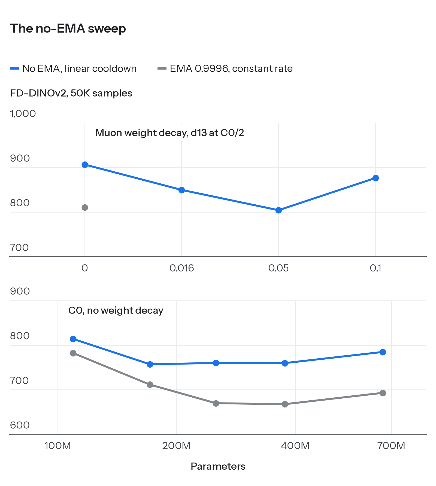

# nano-gpic: the GPIC ladder speedrun

This repository hosts the GPIC ladder speedrun: the fastest way to train the full compute ladder of PixelGen's JiT-T2I on [GPIC](https://gpic.stanford.edu) with 8 NVIDIA H100 GPUs. The ladder is seven models, from 109M to 1.68B parameters, each trained to its budget on GPIC Full: 1.4e19, 2.9e19 and 5.7e19 FLOPs for d9, d10 and d11 and 1.1e20 FLOPs for d12 to d18, where a model dN has N image blocks (plus 2 to 4 text blocks); about 5.6e20 FLOPs in all. We run it to measure scaling laws for pixel-space text-to-image before testing new methods against them, so every hour saved is an hour of the ladder.

**Current record: 419 H100-hours** (52.3 hours on one 8×H100 node), 37.3% MFU.

This is a fork of the GPIC code release ([keshik6/gpic](https://github.com/keshik6/gpic); Chandrasegaran, Sargent et al., 2026; its README is [GPIC_README.md](GPIC_README.md)). Every run, number and figure is on the experiment page, [wenhaochai.com/exps/gpic-speed.html](https://wenhaochai.com/exps/gpic-speed.html); training logs are in [W&B reself/gpic-speed](https://wandb.ai/reself/gpic-speed).

*Updated 2026-11-09.*

## Record history

| # | H100-hours | MFU | Description | Date | Code |
|---|---|---|---|---|---|
| 1 | 682 | 22.9% | The official PixelGen code: DDP, masked SDPA, crops resized on the CPU; AdamW, batch 256 | 2026-11-06 | [7ff7d5b](https://github.com/wenhaochai/nano-gpic/commit/7ff7d5b4) |
| 2 | 571 | 27.4% | FlashAttention-3 for the masked attention, the crop's resize on the GPU (bit for bit Pillow's), uint8 batches, FSDP2 from d14 | 2026-11-06 | [9b5017f](https://github.com/wenhaochai/nano-gpic/commit/9b5017f7) |
| 3 | 530 | 29.5% | Fused Triton kernels for residual + RMSNorm + adaLN modulation and for q/k RMSNorm + RoPE + the k/v concatenation; FSDP2 groups at d11 and d12 | 2026-11-07 | [b642496](https://github.com/wenhaochai/nano-gpic/commit/b642496f) |
| 4 | 438 | 35.7% | Recipe change: Muon (MuP scale) at batch 1024, run as 128 images per GPU with no accumulation; one caption-length bucket per step for all GPUs | 2026-11-07 | [7813166](https://github.com/wenhaochai/nano-gpic/commit/7813166c) |
| 5 | 428 | 36.5% | Patchify and unpatchify by reshape + permute at the FSDP2 sizes (d14 to d18), where they ran outside the compiled blocks and CUDA's unfold launched one im2col kernel per image (the same values bit for bit) | 2026-11-07 | [6560da0](https://github.com/wenhaochai/nano-gpic/commit/6560da0b) |
| 6 | **419** | **37.3%** | Muon's Newton-Schulz with its scalings and sums inside the GEMMs (the same polynomial, rounded once per GEMM) | 2026-11-07 | [0671b0e](https://github.com/wenhaochai/nano-gpic/commit/0671b0e0) |

H100-hours are training time: each model's steps times its mean measured step time times 8 GPUs, summed over the ladder; start-up compiles, checkpoints and evaluations are not counted. Records 1 to 3 run the official AdamW recipe at batch 256 and keep its math. Record 4 changes the recipe, at the same FLOPs per budget: Muon scores 14% to 24% lower FD than AdamW at every point tried. Record 5 keeps record 4's math; its step times at d14 to d18 are record 4's minus the saving measured on the same batches on paired GPU halves (12.5, 14.0 and 13.4 ms per step). Record 6 counts only the sizes measured the same way (4.4, 9.0 and 24.1 ms per step at d12, d16 and d18); its losses match record 5's on the same batches.

## In progress

- **The ladder without the EMA**, as in language-model training: a linear cooldown and Muon weight decay replace the EMA, and every run is scored on its raw weights. The playbook below sweeps the recipe first, then fits the tokens per parameter on iso-FLOP curves, then trains the ladder at that ratio. So far: a linear cooldown over the last 50% of the steps lowers the held-out loss by 0.22% to 0.24% against 20% (sweep CD), and with each size at its best rate the best size has 47 to 49 image tokens per block parameter at 3.6e18, 7.1e18 and 1.4e19 FLOPs (sweep X). The aspect ratio and the rate at four times that compute run now; the iso-FLOP curves at 2.9e19 and 5.7e19 FLOPs come next.
- **NCCL.** NCCL 2.26.2 (the one torch 2.7.1 ships) returns the ranks' blocks of a single-node NVLS all-gather out of order at one message size, 576 KB per rank: the size of d16's final-layer shard, so every d16 checkpoint saved its final layer out of order while training ran correctly (NVIDIA/nccl #1906). Jobs now run NCCL 2.27.7 with NVLS on (checked correct, and 1-2% faster) or 2.26.2 with `NCCL_NVLS_ENABLE=0`.
- **FP8 GEMMs** (`GPIC_MFU_FP8=native3`): the image blocks' forward GEMMs and the MLP's input gradients in FP8, tensorwise scales from the last 16 steps' amax. In the ladder's setting it is 4.8% faster at d12 and 10.4% at d16; the casts to FP8 cost 17.5 and 36.1 ms per step there, against 10.8 and 60.4 ms saved in the GEMMs. FD passed at d9 (986.0, inside the bf16 seeds' 966.6 to 1016.6) but not at d14: at 1.4e19 FLOPs the held-out loss is 0.32% and FD 3.4% worse, about 13% more steps for the same loss, so the ladder stays bf16. At d16 in the recipe without the EMA, FP8 matches bf16 in held-out loss (0.06721 against 0.06721 and 0.06717). A first FP8 run's 10% worse FD came from a resume inside its cooldown, not from FP8: from one saved state, the arm that continues and the arm resumed in a new process reach the same held-out loss and FD 808 against 851. What makes such a resume cost FD is being tested. FP8 weight gradients (`native4`) are being retimed after a 1.8x faster transposing cast.
- **GPU JPEG decoding**: d9 and d10 are bound by the CPU's JPEG decoding. nvJPEG decodes about 84% of the training images in the training step, one step ahead, and the same exact resize runs on them: d9 runs 18% faster (77.2 to 63.1 ms per step), d10 the same, d11 and larger 3% slower. Its FD passed at d9 (984.5). The ladder keeps CPU decoding: d9 is off its critical path. Two bugs were found and fixed on the way: torchvision writes the decoded images on its own CUDA stream without waiting for the caller's, so in a running step it overwrote memory still in use; and a per-image copy loop held Python's lock.

Packed captions are closed: their FD falls inside the shared bucket's seed spread, but they run 1-4% slower than one bucket per step.

## Rules

1. The target is fixed: every model trained to its budget on GPIC Full, 8 H100s per model, the evaluation unchanged.
2. A speed change keeps the math: on the same batches its loss stays within the spread of repeated runs. A change that alters the numerics (FP8, a JPEG decoder, how captions are batched) counts only after an FD check at the official evaluation.
3. A step time is the mean over the second half of an arm of 1024 steps or more, on the production path, with every loss finite.

## Running the current record

```bash
# usage: jobs/train_muon_ladder.sh <full|lite> <size> <d> <blocks> <text blocks> <steps to 1.4e19 FLOPs> <multiple of that budget> <Adam lr> <Muon lr>
bash jobs/train_muon_ladder.sh full d640  640  9  2 133600 1 6.4e-4 3.4e-3
bash jobs/train_muon_ladder.sh full d768  768  10 2 85024  2 5.0e-4 3.4e-3
bash jobs/train_muon_ladder.sh full d896  896  11 2 57600  4 4.1e-4 3.4e-3
bash jobs/train_muon_ladder.sh full d1024 1024 12 3 40192  8 3.3e-4 3.4e-3
bash jobs/train_muon_ladder.sh full d1280 1280 14 3 22400  8 2.4e-4 6.8e-3
bash jobs/train_muon_ladder.sh full d1536 1536 16 4 13600  8 1.8e-4 6.8e-3
bash jobs/train_muon_ladder.sh full d1792 1792 18 4 8992   8 1.4e-4 6.8e-3
```

Each line trains one model on one 8×H100 node, resumes from its last checkpoint, and carries the model's speed settings itself (the scripts name a model by its width). Before the first run: GPIC Full (`tools/download_full.py`) and its Qwen3-1.7B caption features (`jobs/encode_captions.sh`, checked by `tools/check_text_cache.py`). The scripts keep absolute paths and a job-queue wrapper, so set them to yours.

| model (width) | setting | ms per step (1024 images) | MFU |
|---|---|---|---|
| d9 (640) | DDP, 128 × 1 | 76.5 | 17.6% |
| d10 (768) | DDP, 128 × 1 | 83.6 | 25.4% |
| d11 (896) | DDP, 128 × 1 | 103.9 | 30.2% |
| d12 (1024) | DDP, 128 × 1 | 124.5 | 36.0% |
| d14 (1280) | FSDP2, 7 blocks per unit, 128 × 1, patchify by reshape | 198.7 | 40.5% |
| d16 (1536) | FSDP2, 128 × 1, patchify by reshape | 301.0 | 44.0% |
| d18 (1792) | FSDP2, 64 × 2, patchify by reshape | 439.2 | 45.8% |

## The ladder

The goal:

1. Measure how image quality scales with model size, training compute and unique images in pixel-space text-to-image, in the units of language-model scaling studies: FLOP budgets, iso-FLOP curves, tokens per parameter, unique and total tokens.
2. Find how many passes over the data cost nothing, before fitting any optimum.
3. Only then test new methods, each against the ladder at the same compute.

- **Model.** PixelGen's JiT-T2I: x-prediction flow matching, 16-pixel patches (256 image tokens per 256 × 256 image), Qwen3-1.7B caption features. d9, d10, d11, d12, d14, d16 and d18 (widths 640, 768, 896, 1024, 1280, 1536 and 1792), from 109M to 1.68B parameters; the released GPIC model is d16.
- **Recipe of the first Muon ladder.** MiniT2I's settings (Adam, batch 1024, β2 0.95), turned into the MuP version of Muon by lr × 0.2√d ([Su, 2025](https://kexue.fm/archives/11416)): Muon at 3.4e-3 for the transformer matrices (6.8e-3 from d14), Adam for the rest, 1000 warmup steps and a constant rate after them, EMA 0.9996 per step, no CFG.
- **Recipe of the next ladder (no EMA).** The same optimizer split, 1% warmup, a linear cooldown over the last 50% of the steps to an absolute 3e-5, Muon weight decay, the raw weights scored. Its rate, weight decay, shape and tokens per parameter come from the sweeps below.
- **Budgets.** One run per model, read at 3.6e18, 7.1e18, 1.4e19, 2.9e19, 5.7e19 and 1.1e20 FLOPs.
- **Data.** GPIC Full (101.1M images) and GPIC Lite (10.1M), plus repetition arms on the first 80 shards (1.01M images) and the first 8 (101K).
- **Scores.** FD-DINOv2 with the official evaluation (Euler at 50 steps, 50,000 test captions, one noise for all prompts, CFG 1), the official Inception metrics (FD, precision, recall, density, coverage, MMD), and the loss on 3072 held-out images at 16 noise levels with fixed noise.

How we build the ladder, in order:

1. The recipe without the EMA: optimizer split, warmup, linear cooldown, raw weights.
2. The learning rate, by size, at a small budget (3.6e18 FLOPs).
3. Weight decay, as a fraction of the run: the decay timescale 1/(lr·wd).
4. The shape: depth against width at a fixed number of parameters.
5. The batch against the steps at a fixed compute, with the steps of one ladder within a factor of ten.
6. Iso-FLOP curves at 3.6e18, 7.1e18 and 1.4e19 FLOPs with the best recipe: the best size at each compute and the tokens per parameter.
7. The ladder itself: one run per size at that ratio, each with its own cooldown.
8. Every rung scored as above, and fitted as y = E + a·C^(−b) against the baseline's compute.
9. Repetition: how many passes over the unique images cost nothing.

## What we have so far


Every evaluation of every run, against training compute 6ND. Blue is the main line, the Muon ladder on GPIC Full, and the light-blue line follows the lowest FD of each of its budgets; red is the released GPIC model; both in the standard evaluation (Euler 50, the official noise, CFG 1). Grey is every other evaluation.


1. **The Muon recipe beats the AdamW recipe at every point.** On GPIC Full at the same images, Muon scores 14% to 24% lower FD than the official AdamW recipe at all twelve points tried (d9 to d12, 3.6e18 to 1.4e19 FLOPs). This compares recipe against recipe: the batch and the rates change with the optimizer.


2. **The first Muon ladder on GPIC Full.** In the held-out loss, the lowest point of each budget falls from 0.06857 at 3.6e18 FLOPs to 0.06446 at 1.1e20 FLOPs, and the best size grows with compute, from d9 to d16; in FD from 979.3 to 338.9 (d16). From 5.7e19 FLOPs on the ladder beats the released GPIC model (d16, AdamW, one pass over Full, 1.4e20 FLOPs; held-out 0.06536 scored with its own text path, FD 472.4 at CFG 1) with less than half its compute.
3. **The learning rate falls slowly with run length.** In short runs the largest rate tried wins; at 1.4e19 FLOPs, 6.8e-3 beats 3.4e-3 by 5.9% at d14 (22.4k steps) and 3.1% at d12 (40.2k), and ties at d9 (133.6k). Smaller rates lose at every size: at 1.4e19 FLOPs, 1.7e-3 is 2.4%, 2.1% and 11.2% worse than 3.4e-3 at d9, d10 and d12, and 0.85e-3 is 11.6% worse at d9.


4. **The EMA lags in short runs.** The EMA starts at the initial weights and keeps 0.9996^step of them. Above a 1% share its held-out loss is 4.5% to 590% above the raw weights'; below 0.2% it is 0.3% to 0.8% lower. Short runs and the first budgets of the largest models are read from the raw weights or need a later EMA; the ladder has since dropped the EMA.


5. **Without the EMA.** At the same compute, runs with a linear cooldown and no weight decay score 5% to 14% higher FD than the EMA ladder. Muon weight decay closes the gap: at d11 and 7.1e18 FLOPs, 0.05 lowers FD from 906.6 to 804.3 (the EMA ladder: 810.8) and FID from 66.99 to 56.83; its decay timescale is 0.2 of the run. At 3.6e18 FLOPs the best Muon rate is 1.36e-2 at all four sizes tried, up to 5.44e-2; at about 250M parameters deeper, narrower models score better (d16 874.6, d11 906.6, d4 1148.6). Sweep X then trains each size at three rates around a rate rule at 3.6e18, 7.1e18 and 1.4e19 FLOPs: with each size at its best rate, the best size is 120M, 171M and 248M block parameters (47 to 49 image tokens per parameter at all three budgets) and grows as compute to the power 0.53; at a fixed rate it had been 58, 36 and 30 tokens per parameter.
6. **Repetition.** On the AdamW ladders, GPIC Lite costs nothing up to 17 passes over its 10.1M images: its held-out loss is within −0.12% to +0.07% of Full's at the same model and step. Without the EMA, d10 at 7.1e18 FLOPs scores a lower FD on fewer unique images (101K: 827.5, against 892.9 on Full), which may reward copying the training images; the held-out loss decides.
7. **FD needs care.** Nine runs of d9 whose held-out loss agrees to 0.07% span FD 949 to 1017. With one caption-length bucket per step, FD depends on the seed (966.6 to 1016.6) and averages 4% above runs with thirty-two buckets per step, which repeat within 0.3%. The ladder keeps the one-bucket setting, the fastest, and reads small FD gaps between single runs from the held-out loss.
8. **Fixes.** A torch 2.7.1 Inductor C++-wrapper template dropped a reference to `None` on every compiled call and crashed long runs (`src/utils/patch_bugs.py`). The shared caption bucket hung at the end of a data pass and dropped unfinished batches there (`src/data/shared_bucket_loader.py`, `src/data/dataset/gpic_dataset.py`).

## Where the code is

| Branch | Contents |
|---|---|
| `main` | the production line: the ladder (per-model speed settings, Muon also under FSDP2, the shared caption bucket), `jobs/train_muon_ladder.sh`, `configs_h100/muon_ladder.yaml`, and the job scripts of the learning-rate, EMA, caption-bucket and batch experiments |
| `ladder-sweep` | the sweep without the EMA: a linear cooldown to an absolute floor (`WarmupFlatCooldown` min_lr) and Muon weight decay on the ladder's code |
| `sweep-noema`, `sweep-noema-cap` | the same with no EMA update at all (`GPIC_MFU_NO_EMA=1`), and with the shared caption bucket's pools capped |
| `sweep-noema-sched` | the cooldown's shape and length (`WarmupFlatCooldown` shape linear or 1−√): the cooldown sweep and the rate and batch checks at larger compute |
| `heldout-release` | `tools/heldout_release.py`: the released model's held-out loss with its own text path (captions padded to 300 tokens, no mask) |
| `ladder-pnsr`, `ladder-pnsr-ma` | the ladder's later segments: Newton-Schulz in the GEMMs, the GPU resize kernels, and Muon's per-part updates in one launch |
| `eval-official` | the official evaluation with the Inception metrics on every run (`tools/official_inception.py`) |
| `mfu` | speed work: fused kernels, FSDP2, packed captions, FP8, GPU decoding; the log is `docs/mfu.md` |
| `muon-search2` | job scripts of the learning-rate, EMA, caption-bucket and batch experiments |
| `heldout-loss` | `tools/heldout_loss.py`: held-out and training loss at fixed noise, EMA and raw weights |
| `eval-par` | `jobs/evals_gmflow.sh --par`: one evaluation per GPU, eight side by side |
| `ladder` | the first ladder: the official AdamW recipe on GPIC Lite, no caption dropout |
| `muon` | the first optimizer ablation: Muon against AdamW at the official recipe |
| `gmflow` | a Gaussian mixture of the velocity at each step (K = 1, 8, 16) |
| `dist-step` | a distribution per step: notes and tests |
| `energy-head` | an energy-score head over the whole image |
| `ar` | autoregressive sampling of the image tokens |
| `implicit-nodrop` | a posterior sampler, and the point model without caption dropout |
