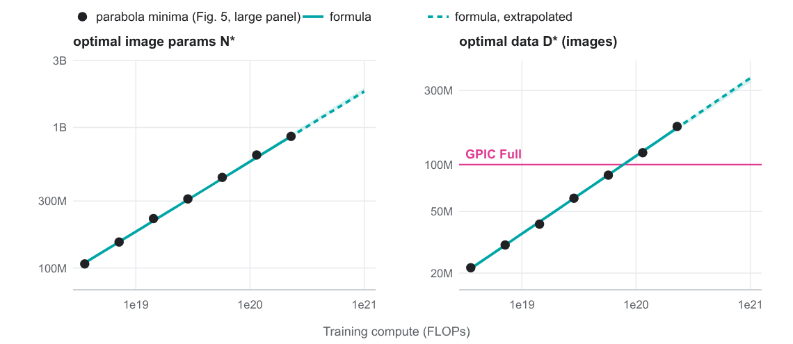

# nano-gpic: a compute ladder for pixel-space text-to-image

The code of the post [How to Scale Text-to-image Models: a Handbook](https://wenhaochai.com/blogs/scaling-generative-models-101.html). It trains a compute ladder of PixelGen's JiT-T2I on [GPIC](https://gpic.stanford.edu) (100M text-image pairs) with 8 NVIDIA H100 GPUs per model, scores each model by its held-out loss, and fits one scaling law to 38 runs from 3.6e18 to 2.3e20 FLOPs.

Every run of the post, with its training logs and the commit it ran on, is on the [experiment page](https://wenhaochai.com/exps/gpic-speed.html); the logs are in [W&B reself/gpic-speed](https://wandb.ai/reself/gpic-speed). This is a fork of the GPIC code release ([keshik6/gpic](https://github.com/keshik6/gpic); Chandrasegaran, Sargent et al., 2026), whose README is [GPIC_README.md](GPIC_README.md).

*Updated 2026-11-15.*

## The final ladder

One model per budget, at the size the scaling law picks: about 50 image tokens per image parameter.

| Size | d10 | d11 | d12 | d13 | d14 | d16 | d18 |
|---|---|---|---|---|---|---|---|
| Compute (FLOPs) | 3.6e18 | 7.1e18 | 1.4e19 | 2.9e19 | 5.7e19 | 1.1e20 | 2.3e20 |
| Width | 768 | 896 | 1024 | 1152 | 1280 | 1536 | 1792 |
| Image layers | 10 | 11 | 12 | 13 | 14 | 16 | 18 |
| Text layers | 2 | 2 | 3 | 3 | 3 | 4 | 4 |
| Image parameters | 106M | 159M | 226M | 311M | 413M | 679M | 1.04B |
| Steps at batch 1024 | 21,248 | 28,800 | 40,192 | 59,136 | 89,600 | 108,800 | 143,872 |
| Tokens per parameter | 52.5 | 47.5 | 46.5 | 49.9 | 56.9 | 42.0 | 36.2 |
| Held-out loss | 0.06788 | 0.06707 | 0.06628 | 0.06558 | 0.06487 | 0.06416 | 0.06351 |

The recipe, the same at every size:

| Setting | Value |
|---|---|
| Optimizer | Muon for the matrix parameters, AdamW for the rest |
| Muon learning rate | 1.36e-2 × (C / 3.6e18)^−0.5 |
| AdamW learning rate | 6.4e-4 × (all parameters / 109.4M)^−0.547 |
| Weight decay | Muon: 5 / (Muon learning rate × steps); AdamW: 0 |
| Batch | 1024 images |
| Schedule | warmup over the first 1% of the steps, linear decay to 3e-5 over the last 50% |
| EMA | none: the raw weights are scored |
| Data | GPIC Full, 99.98M images, a new seeded shard order each pass |
| Shape | width = 128 × (image layers − 4); 2 to 4 text layers |

N, the image parameters, is 18 × image layers × width², the matrices of the image layers (text layers, adaLN and embeddings left out). D counts image tokens: a 256 × 256 image is 256 tokens of 16 × 16 pixels. C = 6ND.

## Running it

Each step runs on one node with 8 H100 GPUs, except the fit. Set `GPIC_WC` to a work root: the data go to `$GPIC_WC/data/gpic`, the runs to `$GPIC_WC/runs/final_ladder`.

1. **Environment.** Python with `baselines/PixelGen/requirements.txt`, FlashAttention 3 and the evaluation toolkit (`pip install -e gpic_eval`). The scripts activate `$GPIC_WC/envs/pixgen`; `GPIC_VENV` names another environment, and `GPIC_VENV=` uses the python on `PATH`. The text encoder, Qwen/Qwen3-1.7B, must be in `$GPIC_WC/cache/huggingface`: the jobs run with the Hugging Face hub offline.
2. **Data.** GPIC Lite, the validation shards, the 50K test captions and the reference statistics, then the rest of GPIC Full; then the captions' Qwen3-1.7B features, once (about 36 GPU-hours and 16.6 TiB for GPIC Full), and a check:
   ```bash
   python tools/download_lite.py $GPIC_WC/data/gpic
   python tools/download_full.py $GPIC_WC/data/gpic
   export PYTHONPATH=$PWD/baselines/PixelGen
   for r in 0 1 2 3 4 5 6 7; do
     CUDA_VISIBLE_DEVICES=$r python tools/encode_captions.py --shards "$GPIC_WC/data/gpic/train/gpic_train_*.tar" \
       --out $GPIC_WC/data/gpic/train_emb_qwen3_1.7b --rank $r --world 8 &
   done; wait
   python tools/check_text_cache.py $GPIC_WC/data/gpic/train_emb_qwen3_1.7b $GPIC_WC/data/gpic/train
   ```
3. **Train** one size. Started again after a stop, a run resumes from its last checkpoint.
   ```bash
   GPIC_WC=/path/to/work bash jobs/final_ladder.sh d12
   ```
4. **Held-out loss**, the post's main metric: the training loss of the raw weights on 3,072 held-out images at 16 fixed noise levels with fixed noise. Build the fixed data once, then score a checkpoint; `loss_val` of the line with `"weights": "raw"` is the post's number.
   ```bash
   python tools/heldout_loss.py prep --n-val 3072 --n-train 3072
   python tools/heldout_loss.py work --ckpt $GPIC_WC/runs/final_ladder/d12/exp_ladder_d1024/ms-step=040192.ckpt --out heldout.jsonl
   ```
5. **FD**, with the official setup except CFG = 1 (50K test captions, one noise for all prompts, Euler at 50 steps): FD-DINOv2 with PRDC and MMD, and the official Inception metrics when `GPIC_TF_PYTHON` names a TensorFlow environment with gpic_eval.
   ```bash
   GPIC_WC=/path/to/work bash jobs/eval_final_ladder.sh d12
   ```
6. **Fit** the scaling law to the post's 38 runs (CPU, about a minute):
   ```bash
   python tools/fit/scaling_law.py --boot 200
   ```

## Results



The held-out loss of the final ladder falls from 0.06788 at 3.6e18 FLOPs (d10) to 0.06351 at 2.3e20 FLOPs (d18). One formula fits the 38 runs with an RMS error of 0.036%:

L(N, D) = E + (A / N^α + B / D^β)^k, with E = 0.0481, A = 1.35e-4, B = 2.33e-3, α = 0.54, β = 0.57, k = 0.22.

The best model grows as N\* ∝ C^0.52 [0.50, 0.53] and its data as D\* ∝ C^0.48, at about 50 image tokens per image parameter with no measurable trend over 64× in compute. Fitted to the 34 runs up to 1.1e20 FLOPs, the formula predicted the four runs at 2.3e20 FLOPs within 0.09%. Extrapolated to 1e21 FLOPs, the optimum is about 1.9B image parameters and 88B image tokens.

## How the ladder was built

Each setting of the recipe, and where the post shows its evidence:

| Setting | Decision | In the post |
|---|---|---|
| Metric | the held-out loss decides; FD-DINOv2 is a reference | [Metric](https://wenhaochai.com/blogs/scaling-generative-models-101.html#metric) |
| EMA | none | [Figure 7](https://wenhaochai.com/blogs/scaling-generative-models-101.html#fig-7) |
| Optimizer | Muon for the matrices, AdamW for the rest | [Figure 8](https://wenhaochai.com/blogs/scaling-generative-models-101.html#fig-8) |
| Learning rate | Muon 1.36e-2 × (C / 3.6e18)^−0.5 | [Figure 9](https://wenhaochai.com/blogs/scaling-generative-models-101.html#fig-9) |
| Weight decay | Muon 5 / (learning rate × steps) | [Figure 10](https://wenhaochai.com/blogs/scaling-generative-models-101.html#fig-10) |
| Batch | 1024 images | [Figure 11](https://wenhaochai.com/blogs/scaling-generative-models-101.html#fig-11) |
| Cooldown | linear to 3e-5 over the last 50% of the steps | [Figure 12](https://wenhaochai.com/blogs/scaling-generative-models-101.html#fig-12) |
| Repetition | up to about 50 passes the held-out loss does not change | [Figure 13](https://wenhaochai.com/blogs/scaling-generative-models-101.html#fig-13) |
| Aspect ratio | width = 128 × (image layers − 4) | [Figure 14](https://wenhaochai.com/blogs/scaling-generative-models-101.html#fig-14) |
| Text layers | 2 to 4 | [Figure 15](https://wenhaochai.com/blogs/scaling-generative-models-101.html#fig-15) |
| Size and data | about 50 image tokens per image parameter | [Our Scaling Law](https://wenhaochai.com/blogs/scaling-generative-models-101.html#tpp) |

## Where the code is

`main` holds the final ladder: `jobs/final_ladder.sh` (training, sizes in `jobs/final_ladder_sizes.sh`), `jobs/eval_final_ladder.sh` (FD), `tools/heldout_loss.py` (held-out loss, tests in `tools/test_heldout_loss.py`) and `tools/fit/` (the scaling law and its 38 runs). The experiment page links every run to the commit it ran on. Research lines have their own branches: `gmflow` and `gmflow-ladder` (a Gaussian mixture of the velocity), `artm-ladder` and `ar` (autoregressive variants), `dist-step`, `energy-head`, `implicit-nodrop`, and `moe`, `moe-run2-noise-eval`, `moe-run3-ewd` (mixtures of experts). The speed work is on `mfu` (log: `docs/mfu.md`); the first Muon ladder and its experiments are in the history of `main` and on `muon-search2`.
