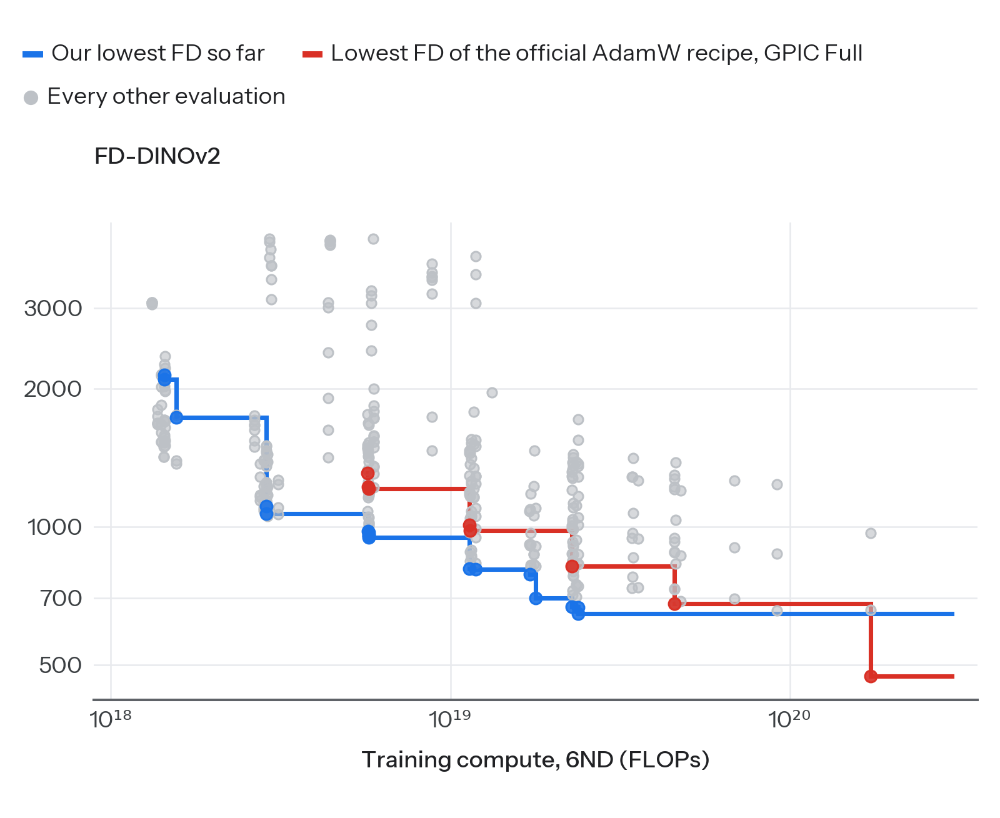
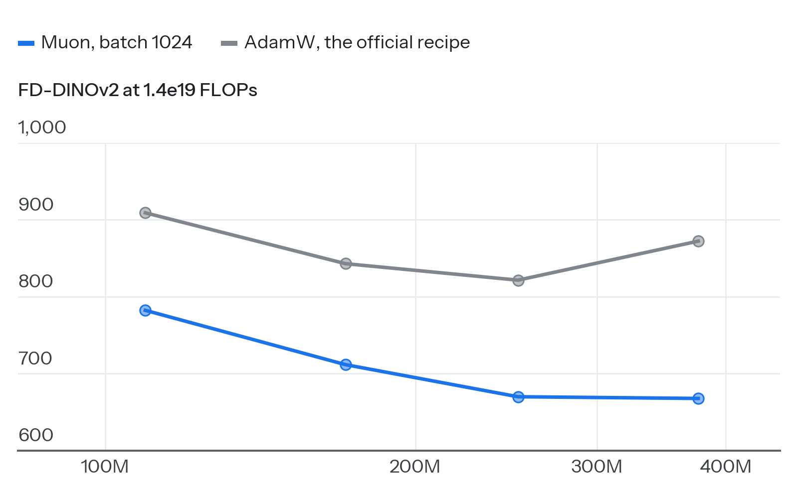
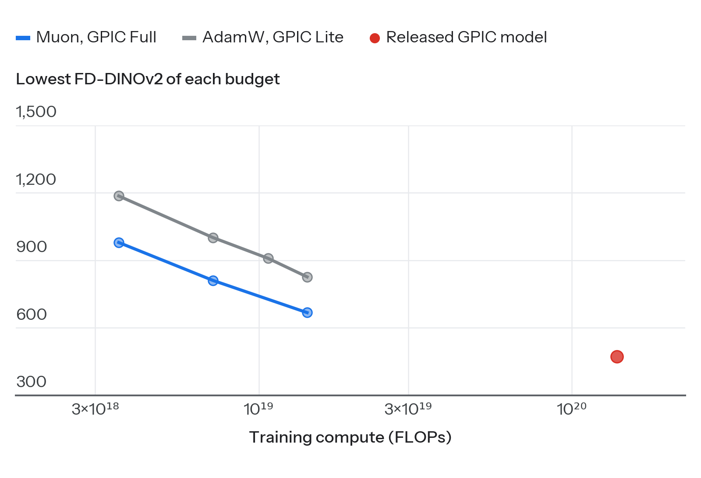
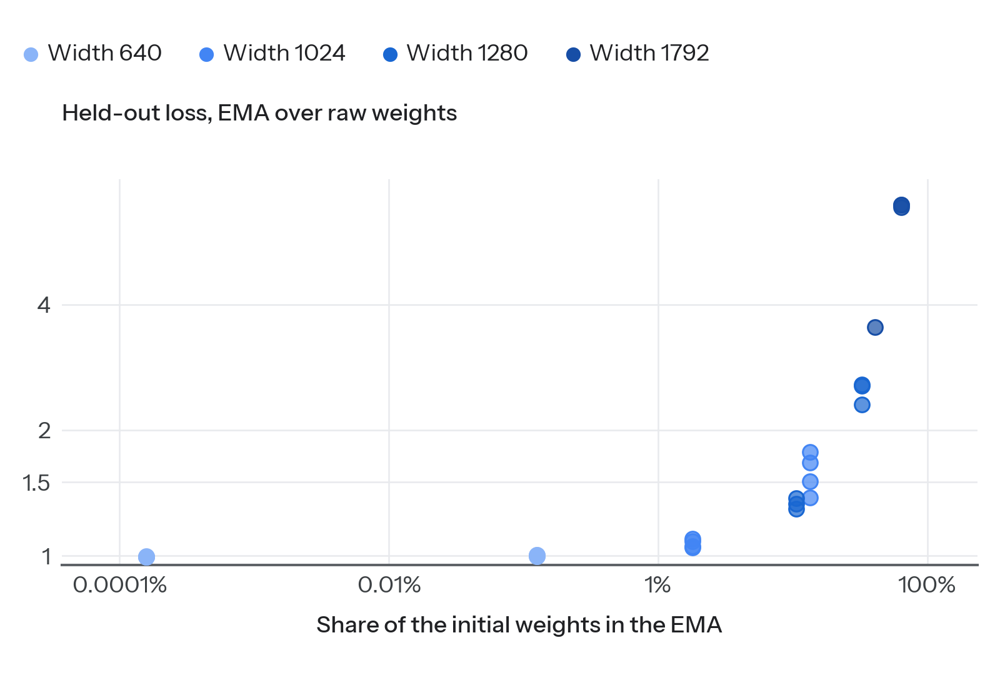

# gpic-baseline

A fast, scaled baseline for pixel-space text-to-image flow matching on [GPIC](https://gpic.stanford.edu): the official PixelGen JiT-T2I model, made faster, trained with Muon and laid out as a compute ladder, so that scaling laws are measured before new methods are tested.

This repository is a fork of the GPIC code release ([keshik6/gpic](https://github.com/keshik6/gpic); Chandrasegaran, Sargent et al., 2026). The original README is [GPIC_README.md](GPIC_README.md). Every run, number and figure is on the experiment page, [wenhaochai.com/exps/gpic-speed.html](https://wenhaochai.com/exps/gpic-speed.html); training logs are in [W&B reself/gpic-speed](https://wandb.ai/reself/gpic-speed).

*Updated 2026-11-07.*

## Goal

1. Measure how image quality scales with model size, training compute and unique images in pixel-space text-to-image, in the units of language-model scaling studies: FLOP budgets, iso-FLOP curves, tokens per parameter, unique and total tokens.
2. Find how many passes over the data cost nothing, before fitting any optimum.
3. Only then test new methods, each against the ladder at the same compute.

## The ladder

- **Model.** PixelGen's JiT-T2I: x-prediction flow matching, 16-pixel patches (256 image tokens per 256 × 256 image), Qwen3-1.7B caption features. Widths 640 to 1792, from 109M to 1.68B parameters.
- **Recipe.** MiniT2I's settings (Adam, batch 1024, β2 0.95), turned into the MuP version of Muon by lr × 0.2√d ([Su, 2025](https://kexue.fm/archives/11416)): Muon at 3.4e-3 for the transformer matrices (6.8e-3 at width 1280, where its own runs prefer it; widths 1536 and 1792 wait for theirs), Adam for the rest, 1000 warmup steps and a constant rate after them, EMA 0.9996 per step, no CFG.
- **Budgets.** C0 = 1.43e19 FLOPs. Width 640 trains to C0, 768 to 2C0, 896 to 4C0, and 1024 to 1792 to 8C0; one run per width is read at C0/4, C0/2, C0, 2C0, 4C0 and 8C0.
- **Data.** GPIC Full (101.1M images) and GPIC Lite (10.1M), plus repetition arms on the first 80 shards (1.01M images) and the first 8 (101K).
- **Scores.** FD-DINOv2 with the official evaluation (Euler at 50 steps, 50,000 test captions, one noise for all prompts, CFG 1), and the loss on 3072 held-out images at 16 noise levels with fixed noise.
- **Speed.** Each width keeps its speed levers behind switches: fused residual-norm and q/k kernels, uint8 crops resized on the GPU, one caption-length bucket per step for all GPUs, and FSDP2 from width 1280. The ladder runs at 35.7% MFU on 8 H100s (29.5% with the AdamW recipe at batch 256), and an evaluation runs on one GPU, eight side by side.

## What we have so far

Every evaluation of every run, against training compute 6ND. Blue is our frontier, the lowest FD reached at or below each compute in the standard evaluation; red is the same frontier for the official AdamW recipe on GPIC Full, its ladder and the released model; grey is every other evaluation, whatever its sampler.

1. **The Muon recipe beats the AdamW recipe at every point.** On GPIC Full at the same images, Muon scores 14% to 24% lower FD than the official AdamW recipe at all twelve points tried (widths 640 to 1024, 3.6e18 to 1.4e19 FLOPs). This compares recipe against recipe: the batch and the rates change with the optimizer.

2. **The ladder on GPIC Full.** At 1.4e19 FLOPs the best widths are 896 and 1024 (FD 669.9 and 667.7), against 826.5 for the AdamW ladder on Lite. The released GPIC model (width 1536, AdamW, one pass over Full, 1.4e20 FLOPs) scores FD 472.4 at CFG 1. Widths 1280 to 1792 and the budgets above C0 are running.
3. **The learning rate falls slowly with run length.** In short runs the largest rate tried wins; at C0, 6.8e-3 beats 3.4e-3 by 5.9% at width 1280 (22.4k steps) and 3.1% at width 1024 (40.2k), and ties at width 640 (133.6k). Smaller rates lose at every width: at C0, 1.7e-3 is 2.4%, 2.1% and 11.2% worse than 3.4e-3 at widths 640, 768 and 1024, and 0.85e-3 is 11.6% worse at width 640.

4. **The EMA lags in short runs.** The EMA starts at the initial weights and keeps 0.9996^step of them. Above a 1% share its held-out loss is 4.5% to 590% above the raw weights'; below 0.2% it is 0.3% to 0.8% lower. Short runs and the first budgets of the widest models are read from the raw weights or need a later EMA; a sweep of the EMA decay is running.
5. **Repetition.** On the AdamW ladders, GPIC Lite costs nothing up to 17 passes over its 10.1M images: its held-out loss is within −0.12% to +0.07% of Full's at the same width and step. The 1.01M and 101K arms (135 to 1350 passes) are running.
6. **FD needs care.** Seven runs at width 640 whose held-out loss agrees to 0.07% differ by up to 7% in FD, depending on how captions are batched: one caption-length bucket per step scores 1006 and 1017, eight buckets 983, packed captions that mix every length in every step 975, and thirty-two buckets 949 to 959. Two repeats with a second seed measure FD's spread between runs; until they report, small FD gaps between single runs are read from the held-out loss.
7. **Fixes.** A torch 2.7.1 Inductor C++-wrapper template dropped a reference to `None` on every compiled call and crashed long runs (`src/utils/patch_bugs.py`). The shared caption bucket hung at the end of a data pass and dropped unfinished batches there (`src/data/shared_bucket_loader.py`, `src/data/dataset/gpic_dataset.py`).

## Where the code is

| Branch | Contents |
|---|---|
| `main` | the production line: the ladder (per-width speed settings, Muon also under FSDP2, the shared caption bucket), `jobs/train_muon_ladder.sh`, `configs_h100/muon_ladder.yaml`, and the job scripts of the learning-rate, EMA, caption-bucket and batch experiments |
| `mfu` | speed work: fused kernels, FSDP2, packed captions, FP8 and GPU decoding benchmarks |
| `muon-search2` | job scripts of the learning-rate, EMA, caption-bucket and batch experiments |
| `heldout-loss` | `tools/heldout_loss.py`: held-out and training loss at fixed noise, EMA and raw weights |
| `eval-par` | `jobs/evals_gmflow.sh --par`: one evaluation per GPU, eight side by side |
| `ladder` | the first ladder: the official AdamW recipe on GPIC Lite, no caption dropout |
| `muon` | the first optimizer ablation: Muon against AdamW at the official recipe |
| `gmflow` | a Gaussian mixture of the velocity at each step (K = 1, 8, 16) |
| `dist-step` | a distribution per step: notes and tests |
| `energy-head` | an energy-score head over the whole image |
| `ar` | autoregressive sampling of the image tokens |
| `implicit-nodrop` | a posterior sampler, and the point model without caption dropout |

Every run used nodes of 8 H100 GPUs, launched through a job queue; the scripts keep absolute paths, so set them to yours.
